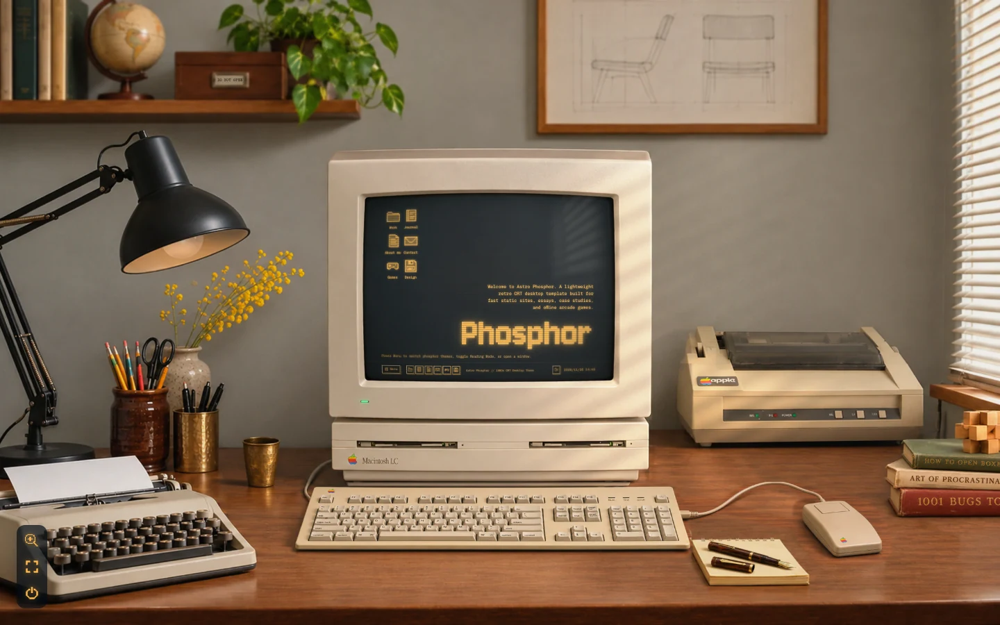
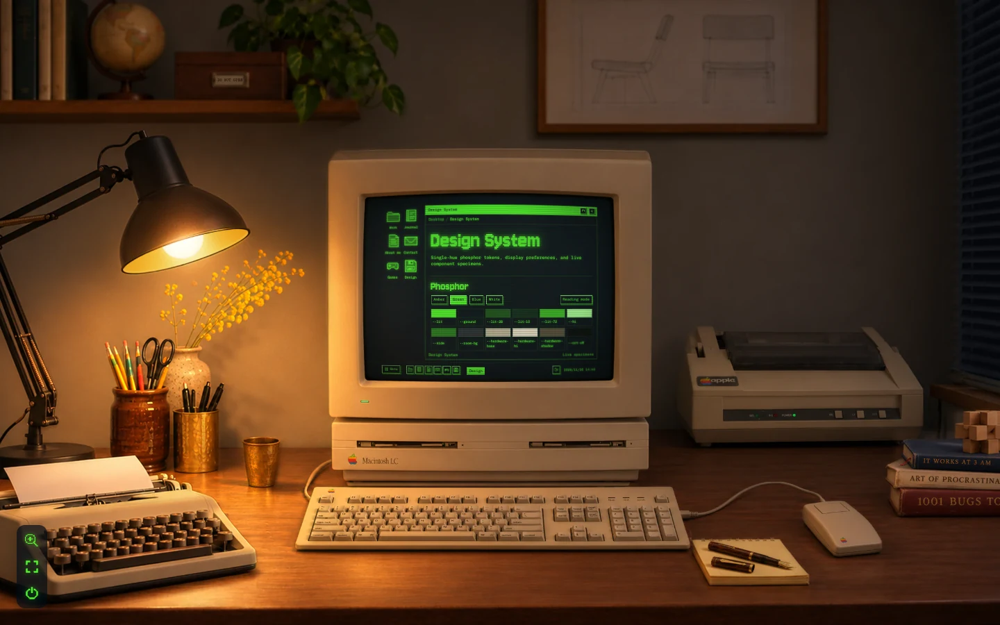
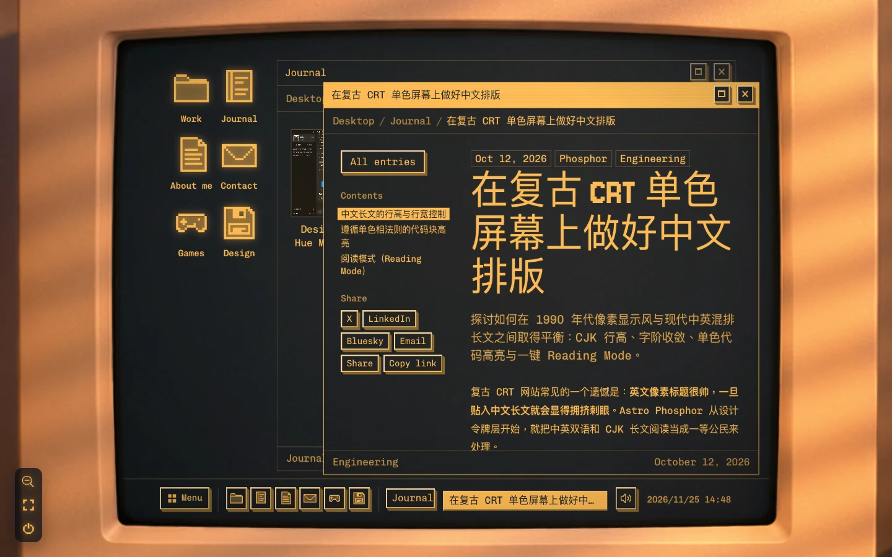

# Astro Phosphor

**English** | [简体中文](./README.zh-CN.md)

A lightweight, **100% static** 1990s beige CRT monitor & monochrome phosphor desktop personal site template built with **Astro 5**, **React 19**, and **Tailwind CSS v4**.

> **Live Template Demo**: [moonoops.github.io/astro-phosphor](https://moonoops.github.io/astro-phosphor/) *(pure static build of this repository)*
>
> **Extended Live Showcase**: [xox.pub](https://xox.pub) *(a personal site built on top of this template — includes extra self-hosted backend features like Chat, Message Board, and Media Decks that are intentionally excluded from this lightweight static template; if you need backend features, you can spin them up quickly with any AI coding assistant using the included specs).*



<table>
  <tr>
    <td width="33.3%">
      
      <br /><sub><b>Night Lighting · Green Phosphor · Design System</b></sub>
    </td>
    <td width="33.3%">
      
      <br /><sub><b>Close Zoom · Reading Mode · Bilingual CJK MDX</b></sub>
    </td>
    <td width="33.3%">
      
      <br /><sub><b>Blue Phosphor · 5 Offline Retro Arcade Games</b></sub>
    </td>
  </tr>
</table>

---

## Core Highlights

- **AI-Friendly, Spec-Driven Architecture**: Built to be customized effortlessly with AI coding assistants (Antigravity, Claude Code, Codex, Cursor, etc.). [`AGENTS.md`](./AGENTS.md) defines the tech stack, Astro/React Island boundaries, route map, and zero-backend constraints; [`docs/DESIGN.md`](./docs/DESIGN.md) locks down the single-hue phosphor tokens, responsive pixel type scale, 0px chrome rules, and Do's/Don'ts; and built-in **Agent Skills** (starting with [`crt-room-artwork`](./.agents/skills/crt-room-artwork/SKILL.md) for generating, relighting, and calibrating custom CRT desk backgrounds) let AI extend pages, windows, or even custom backends cleanly without breaking the retro aesthetic.
- **Astro Static Core + Persistent OS Chrome**: Compiles to 100% static files (`dist/`) with zero backend or database required. Uses `<ClientRouter />` and `transition:persist` so switching windows never replays the CRT warm-up blur or resets camera zoom (`Room` / `Close` / `Fullscreen`).
- **Bilingual MDX Journal & CJK Typography**: Filterable by category, tag, and keyword; sticky scrollspy Table of Contents; monochrome Shiki code blocks; one-click **Reading Mode**; and automatic `lang: zh-CN` CJK line-height (`1.75`) and heading scale tuning.
- **5 Pure-Frontend Offline Retro Games**: Minesweeper, Tetris, Snake, 2048, and 21-floor Magic Tower (`魔塔 21F`) — pure TypeScript, Canvas, synthesized 8-bit Web Audio cues, and `localStorage` high scores & save slots.

---

## Included Routes

| Route | Description |
| :--- | :--- |
| `/` | Retro desktop with 6 symmetrical shortcuts, `TypedText` intro, and hero wallpaper |
| `/work` & `/work/[slug]` | Featured portfolio grid + case study windows + true-color `GalleryLightbox` |
| `/journal` & `/journal/[slug]` | Static MDX blog with search/category/tag filters, TOC scrollspy & Reading Mode |
| `/about` | Profile, pixel avatar, desk specs, `SetupWizard`, principles, timeline & `FAQPanel` |
| `/contact` | Retro email composer (`mailto:` handoff or local `.txt` draft download) |
| `/design-system` | Live interactive token, typography, button, form, icon & widget specimen sheet |
| `/games` | Offline Arcade hub launching Minesweeper, Tetris, Snake, 2048, and Magic Tower |
| `/404` | Classic compact retro error dialog |

---

## Quick Start

Requires **Node.js `^20.19.0` or `>= 22.12.0`**.

```sh
npm install
npm run dev
```

Open `http://localhost:4321` in your browser.

### Useful Commands

```sh
npm run check         # Astro diagnostics + strict TypeScript check
npm run build         # Build 100% static site into dist/
npm run preview       # Preview the production dist/ build locally
npm run art:room      # Optimize custom 5-scene room plates into responsive WebP
npm run test:browser  # Run Playwright E2E checks (requires Chrome)
```

---

## Personalize & Customize with AI

1. **Site Identity & Links**: Edit [`src/site.ts`](./src/site.ts) and [`src/data/page-copy.json`](./src/data/page-copy.json).
2. **Portfolio Projects**: Edit or replace the sample `.mdx` entries in [`src/content/projects/`](./src/content/projects/) and place screenshots in `public/media/work/`.
3. **Journal Essays**: Add `.mdx` posts in [`src/content/journal/`](./src/content/journal/). Set `lang: zh-CN` for Chinese articles or `draft: true` to hide unfinished drafts.
4. **Contact Email & Site Origin**: Copy `.env.example` to `.env`:
   - Set `PUBLIC_CONTACT_EMAIL` to enable `mailto:` handoff from `/contact` (leave blank to let visitors download `.txt` drafts locally).
   - Set `SITE_URL` (and optionally `SITE_BASE` for subpath hosting) before `npm run build`.
5. **Custom CRT Desk Backgrounds (Built-in Agent Skill)**: Ask your AI coding agent to follow [`.agents/skills/crt-room-artwork/SKILL.md`](./.agents/skills/crt-room-artwork/SKILL.md) to generate a custom 1990s computer desk plate, create 5 pixel-aligned time-of-day lighting scenes (`morning` / `noon` / `afternoon` / `dusk` / `night`), compress them with `npm run art:room`, and calibrate `src/geometry/tube.ts`.
6. **Preview Time-of-Day Scenes**: Append `?scene=morning`, `?scene=noon`, `?scene=afternoon`, `?scene=dusk`, or `?scene=night` to any URL.

---

## Deploy Anywhere (Static Hosting)

- **GitHub Pages (Included Workflow)**: Click **Use this template**, enable **Settings → Pages → Source: GitHub Actions**, and every push to `main` automatically deploys via [`.github/workflows/deploy-pages.yml`](./.github/workflows/deploy-pages.yml) (subpath `SITE_BASE` is configured automatically).
- **Cloudflare Pages / Vercel / Netlify**: Connect the repository, set build command `npm run build` and output directory `dist`.

Make sure your host serves `dist/404.html` for missing routes so the retro error dialog appears automatically.

---

## Credits & License

- Visual aesthetic inspired by *Nostalgia Computer* — all code, pixel icons, optical masks, and Macintosh LC room plates in this repository are independently authored/generated.
- *Magic Tower (魔塔 21F)* gameplay inspired by `ckcz123/mota-js`, rebuilt from scratch in TypeScript and monochrome Canvas.
- Self-hosted fonts: *Jersey 10* and *Chivo Mono* via Fontsource.

Licensed under the [MIT License](./LICENSE).
