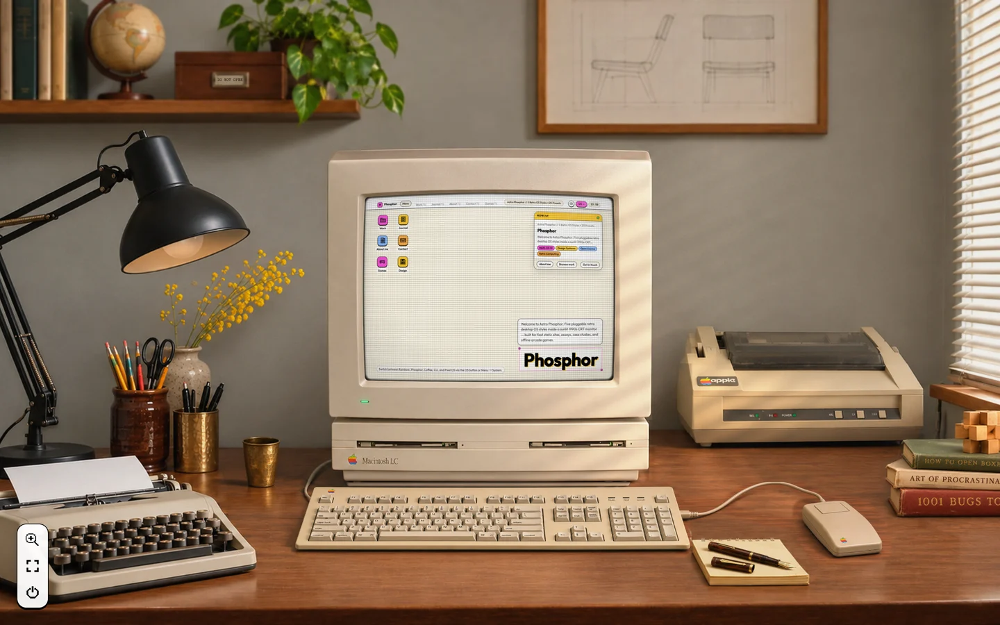
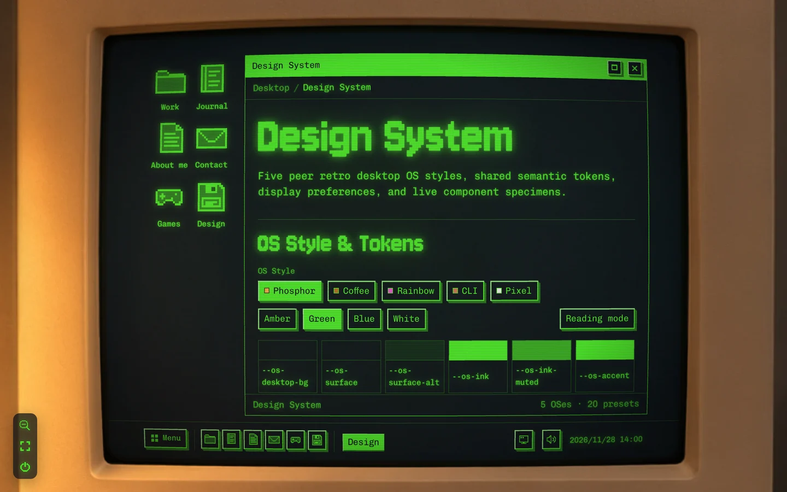
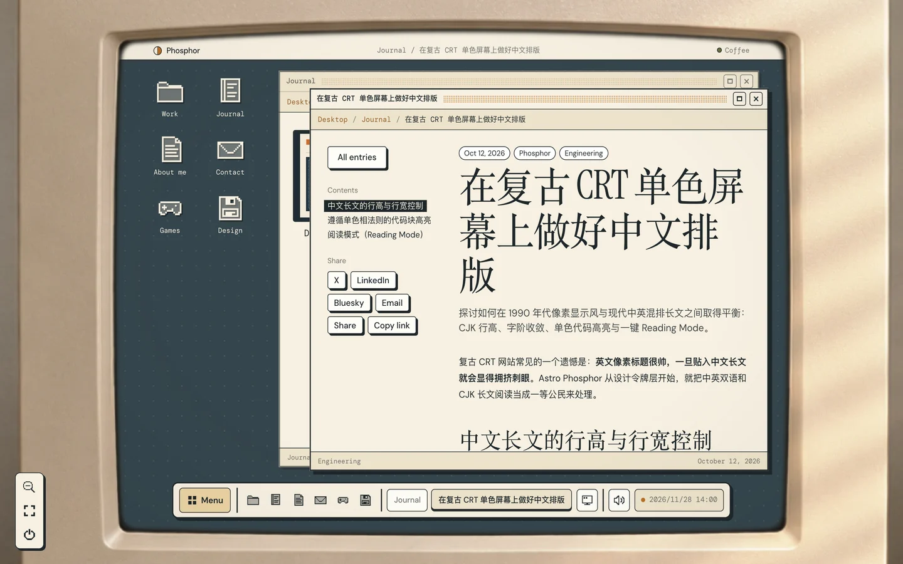
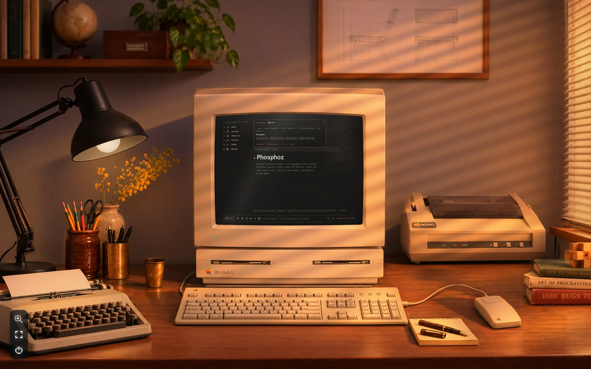
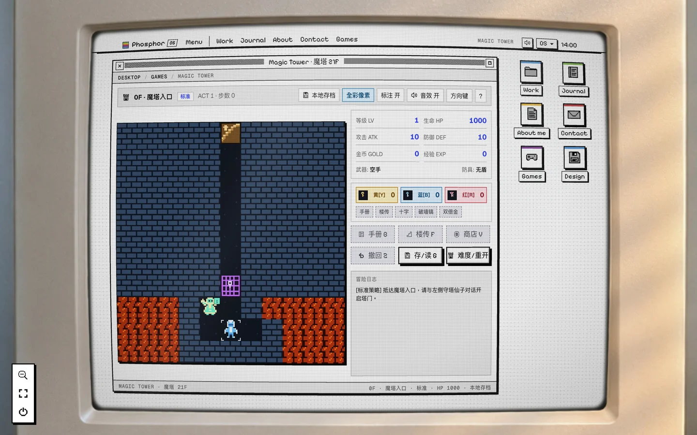

# Astro Phosphor

**English** | [简体中文](./README.zh-CN.md)

A **100% static** 1990s **CRT desk & multi-OS** personal site template hosting **5 switchable retro desktop OS styles (20 theme presets)** inside a sunlit Macintosh LC monitor — built with **Astro 5**, **React 19**, and **Tailwind CSS v4**.

> **Live Template Demo**: [moonoops.github.io/astro-phosphor](https://moonoops.github.io/astro-phosphor/) *(pure static build of this repository)*
>
> **Extended Live Showcase**: [xox.pub](https://xox.pub) *(a personal site built on top of this template — includes extra self-hosted backend features like Chat, Message Board, and Media Decks that are intentionally excluded from this lightweight static template; if you need backend features, you can spin them up quickly with any AI coding assistant using the included specs).*



<table>
  <tr>
    <td width="50%">
      
      <br /><sub><b>Phosphor CRT OS · Night Lighting · Live 5-OS Design System</b></sub>
    </td>
    <td width="50%">
      
      <br /><sub><b>Coffee OS · Reading Mode · Bilingual CJK MDX Journal</b></sub>
    </td>
  </tr>
  <tr>
    <td width="50%">
      
      <br /><sub><b>CLI OS · Dusk Lighting · Prompt-Style Developer Desktop</b></sub>
    </td>
    <td width="50%">
      
      <br /><sub><b>Pixel OS · Morning Lighting · 5 Offline Retro Games (Magic Tower 21F)</b></sub>
    </td>
  </tr>
</table>

---

## 5 Peer Pluggable Retro Desktop OS Styles (`20` Theme Presets)

Switch OS styles at runtime via the **OS** button in the menu bar / dock, **Menu → System**, `/design-system`, or by appending `?os=<id>` to any URL (zero FOUC, per-OS theme memory):

| OS Style | `data-os` | Presets (`20` total) | Aesthetic & Chrome Topology | Spec |
| :--- | :---: | :--- | :--- | :--- |
| **Rainbow** *(Default)* | `rainbow` | `studio`, `marigold`, `sky`, `classic` | Daylight CMY creative studio, cream drafting graph paper, top `*.fig` tab bar, `NOW.txt` sticky card, squircle windows | [docs/os/rainbow/DESIGN.md](./docs/os/rainbow/DESIGN.md) |
| **Phosphor** | `phosphor` | `amber`, `green`, `blue`, `white` | Classic single-hue glowing monochrome CRT (`0px` corners, 3D extruded pixel keys, bottom Win95-inspired taskbar) | [docs/os/phosphor/DESIGN.md](./docs/os/phosphor/DESIGN.md) |
| **Coffee** | `coffee` | `roast`, `matcha`, `indigo`, `oat` | Archival editorial paper & *Instrument Serif*, passive top status bar + floating bottom dock, tilted sand `NOW.txt` note | [docs/os/coffee/DESIGN.md](./docs/os/coffee/DESIGN.md) |
| **CLI** | `cli` | `claude`, `light`, `dark`, `matrix` | Prompt-style developer terminal in pure `IBM Plex Mono`, shell directory rail, welcome box & pinned bottom command dock | [docs/os/cli/DESIGN.md](./docs/os/cli/DESIGN.md) |
| **Pixel** | `pixel` | `paper`, `slate`, `mint`, `sky` | Classic Macintosh System 7 1-bit pixel dots, top rainbow menu bar, 6-line pinstripe titlebars & right-aligned icon rail | [docs/os/pixel/DESIGN.md](./docs/os/pixel/DESIGN.md) |

---

## Core Highlights

- **Three-Layer Pluggable Architecture**:
  - **Layer 1 — Physical Hardware Shell** ([`docs/os/hardware.md`](./docs/os/hardware.md)): Calibrated `1672 × 941` Macintosh LC desk plates, 5 local-clock time-of-day scenes (`morning`, `noon`, `afternoon`, `dusk`, `night`), 3 camera views (`Room` / `Close` / `Fullscreen` with click-to-close auto-zoom), cathode-ray power collapse/warm-up physics, and curved 7-layer CRT optics (barrel curvature, scanlines, aperture grille, glass patina, reflections).
  - **Layer 2 — Peer OS Registry** (`src/os/`): Strictly isolated `html[data-os="<id>"]` tokens & chrome, zero-duplication top/bottom bar chrome, and 5 dynamic SVG cursor sets (`PixelCursors.tsx`) matching each OS palette.
  - **Layer 3 — Shared Static Apps & Content**: Built once against the Shared Semantic Token Contract (`--os-*` + legacy bridge) in [`docs/DESIGN.md`](./docs/DESIGN.md).
- **AI-Friendly, Spec-Driven + Built-In Agent Skills**: Ships with [`AGENTS.md`](./AGENTS.md), [`docs/DESIGN.md`](./docs/DESIGN.md), 5 per-OS specs, plus two ready-to-use **Agent Skills**:
  - **[`add-os-style`](./.agents/skills/add-os-style/SKILL.md)** — add a brand-new peer retro desktop OS style with isolated tokens, chrome, cursors, and Playwright checks.
  - **[`room-backdrop`](./.agents/skills/room-backdrop/SKILL.md)** — generate, optimize (`npm run art:room`), and calibrate a custom 1990s monitor/desk room photograph and its 5 time-of-day lighting scenes.
- **100% Static + Persistent Chrome**: Compiles to plain files in `dist/` with zero backend, zero database, and zero `/api/` requests. `<ClientRouter />` + `transition:persist` keeps OS chrome, theme, scene, and camera zoom intact across navigations without replaying boot animations.
- **Bilingual MDX Journal & Reading Mode**: Category/tag/keyword search, sticky scrollspy Table of Contents, OS-matched Shiki code highlighting, automatic `lang: zh-CN` CJK typography rules, and one-click **Reading Mode** that softens CRT optics for comfortable long-form reading.
- **5 Pure-Frontend Offline Retro Games**: Minesweeper, Tetris, Snake, 2048, and 21-floor Magic Tower (`魔塔 21F` with Standard & Hard difficulties, 9 monster traits, Hybrid/Full-Color toggle, and 4 `localStorage` save slots) — adapting live to monochrome CRT on Phosphor and vivid color palettes on Rainbow/Coffee/CLI/Pixel.

---

## Included Routes

| Route | Description |
| :--- | :--- |
| `/` | Retro desktop with 6 symmetrical shortcuts, optional `NOW.txt` widget, `TypedText` intro & hero wallpaper |
| `/work` & `/work/[slug]` | Featured portfolio grid + stacked case study windows + true-color `GalleryLightbox` |
| `/journal` & `/journal/[slug]` | Static bilingual MDX blog with search/category/tag filters, TOC scrollspy & Reading Mode |
| `/about` | Profile, pixel avatar, desk specs, `SetupWizard`, principles, timeline & `FAQPanel` |
| `/contact` | Retro email composer (`mailto:` handoff or local `.txt` draft download) |
| `/design-system` | Live 5-OS & 20-preset switcher, semantic tokens, typography scale, buttons, forms, icons & interactive specimens |
| `/games` | Offline Arcade hub launching Minesweeper, Tetris, Snake, 2048, and Magic Tower 21F |
| `/404` | Compact retro alert dialog |

---

## Quick Start

Requires **Node.js `^20.19.0` or `>= 22.12.0`**.

```sh
npm install
npm run dev
```

Open `http://localhost:4321` in your browser.

### Useful Commands

```sh
npm run check         # Astro diagnostics + strict TypeScript check
npm run build         # Build 100% static site into dist/
npm run preview       # Preview the production dist/ build locally
npm run art:room      # Optimize custom 5-scene room plates into responsive WebP
npm run test:browser  # Run Playwright multi-OS & offline E2E checks (requires Chrome)
```

---

## Personalize & Customize with AI

1. **Site Identity & Links**: Edit [`src/site.ts`](./src/site.ts) and [`src/data/page-copy.json`](./src/data/page-copy.json).
2. **Portfolio Projects**: Replace the sample `.mdx` case studies (`field-guide`, `signal-kit`, `trail-map`) in [`src/content/projects/`](./src/content/projects/) and place covers in `public/media/work/`.
3. **Journal Essays**: Add `.mdx` posts in [`src/content/journal/`](./src/content/journal/). Set `lang: zh-CN` for Chinese articles or `draft: true` to hide drafts.
4. **Default OS & URL Previews**: Change `DEFAULT_OS` in [`src/os/registry.ts`](./src/os/registry.ts), or preview any combination via URL query params: `?os=rainbow|phosphor|coffee|cli|pixel` and `?scene=morning|noon|afternoon|dusk|night`.
5. **Contact Email & Site Origin**: Copy `.env.example` to `.env`:
   - Set `PUBLIC_CONTACT_EMAIL` to enable `mailto:` handoff from `/contact` (leave blank to let visitors download `.txt` drafts locally).
   - Set `SITE_URL` (and optionally `SITE_BASE` for subpath hosting) before `npm run build`.
6. **Add a New OS Style or Swap the Desk Backdrop (Built-in Agent Skills)**:
   - Ask your AI coding assistant to follow [`.agents/skills/add-os-style/SKILL.md`](./.agents/skills/add-os-style/SKILL.md) to craft a 6th peer OS style.
   - Ask it to follow [`.agents/skills/room-backdrop/SKILL.md`](./.agents/skills/room-backdrop/SKILL.md) to generate and calibrate a custom 5-scene desk backdrop with `npm run art:room`.

---

## Deploy Anywhere (Static Hosting)

- **GitHub Pages (Included Workflow)**: Click **Use this template**, enable **Settings → Pages → Source: GitHub Actions**, and every push to `main` automatically deploys via [`.github/workflows/deploy-pages.yml`](./.github/workflows/deploy-pages.yml) (subpath `SITE_BASE` is configured automatically via `withBase()`).
- **Cloudflare Pages / Vercel / Netlify**: Connect the repository, set build command `npm run build` and output directory `dist`.

Make sure your host serves `dist/404.html` for missing routes so the retro error dialog appears automatically.

---

## Credits & License

- **Design Inspiration**: Thanks to **@realmehedi1** for the free Framer template (*Nostalgia Computer*) that inspired the original Phosphor CRT aesthetic, along with classic retro OS craft (*Amara Makes*, *Prompt OS*, *Vintage OS*, *Macintosh System 7*). All code, pixel icons, optical shaders, and desk artwork in this repository are independently authored/generated.
- **Community**: Special thanks to the **[LINUX DO](https://linux.do)** community for the open-source spirit, discussions, and feedback.
- **Offline RPG**: *Magic Tower (魔塔 21F)* combat & critical formulas inspired by `ckcz123/mota-js` (BSD-3-Clause), rebuilt from scratch in TypeScript and Canvas.
- **Self-Hosted Fonts (via Fontsource)**: *Jersey 10*, *Chivo Mono*, *Instrument Serif*, *DM Sans*, *DM Mono*, *Outfit*, *IBM Plex Mono*, *Geist Pixel*, *Pixelify Sans*, *Geist*, and *Geist Mono*.

Licensed under the [MIT License](./LICENSE).
