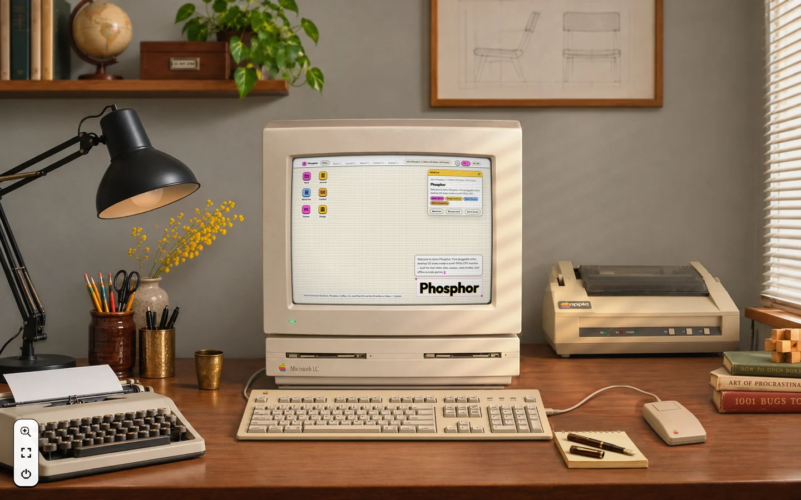
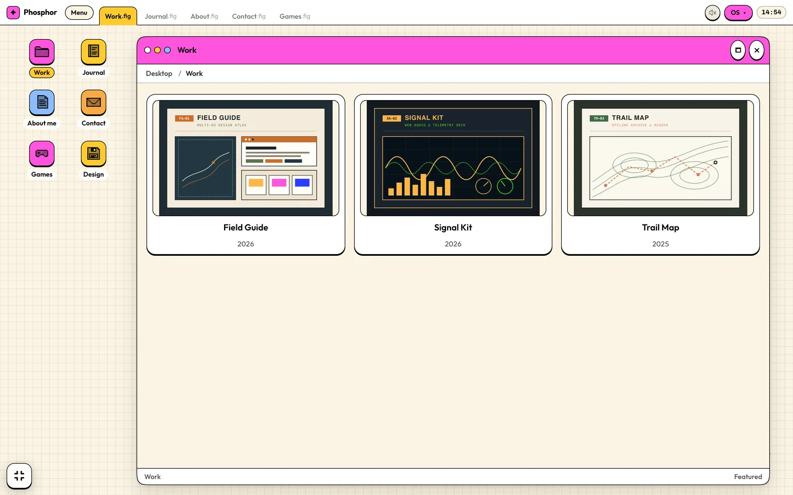
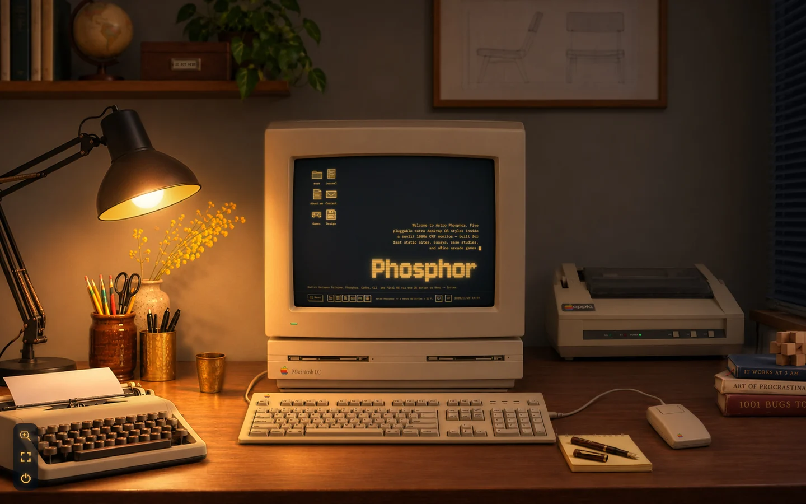
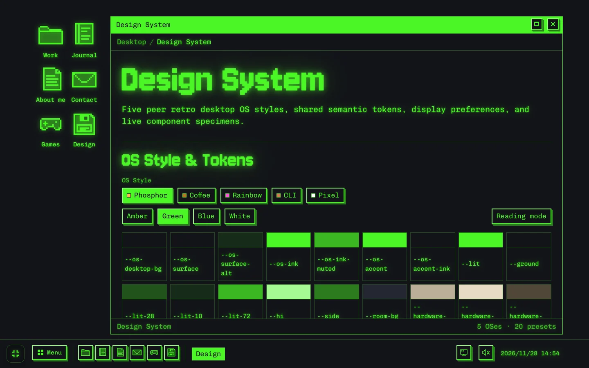
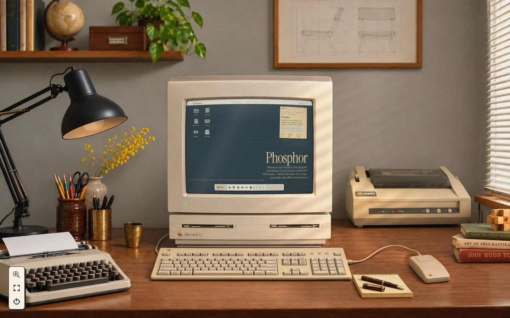
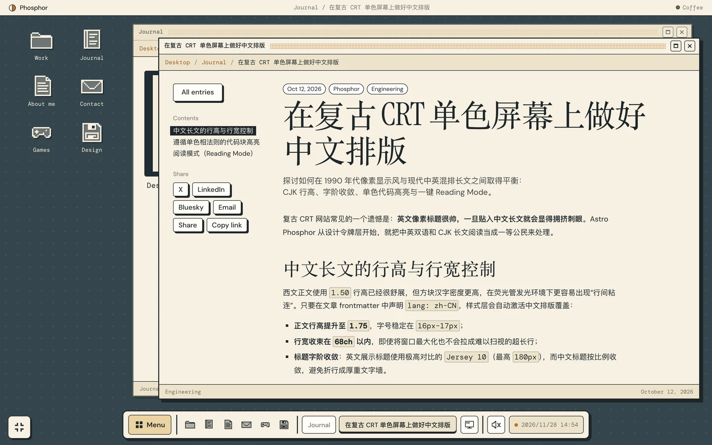
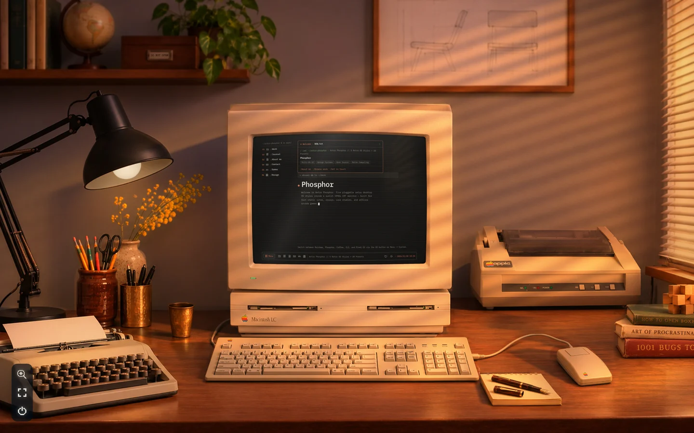
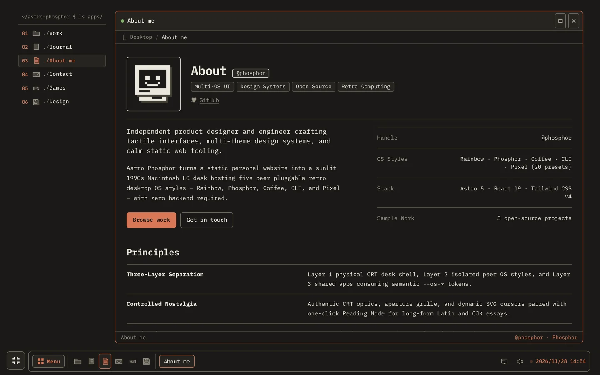
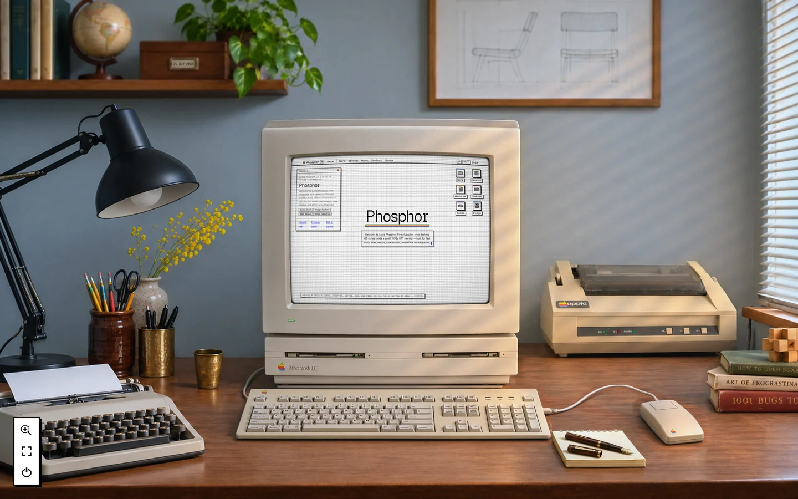
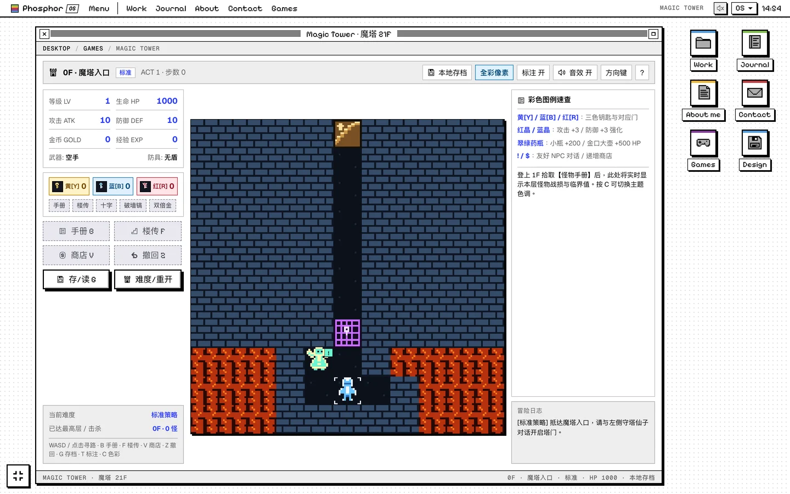

# Astro Phosphor

[English](./README.md) | **简体中文**

一个轻量、**100% 纯静态**的 1990 年代 **CRT 书桌 + 多系统复古桌面**个人站模板：在阳光洒落的 Macintosh LC 显示器中内置 **5 套可热切换的平行复古 OS 风格（共 20 套主题预设）**，基于 **Astro 5**、**React 19** 与 **Tailwind CSS v4** 构建。

> **纯净模板在线 Demo**：[moonoops.github.io/astro-phosphor](https://moonoops.github.io/astro-phosphor/)（本仓库自动构建的纯静态预览）
>
> **线上实景扩展站**：[xox.pub](https://xox.pub)（基于本模板扩展的个人站点。注意：`xox.pub` 额外接入了 Chat 聊天室、留言板、音视频播放器等需要后端服务的功能，本轻量纯静态模板暂不提供这些后端能力；如有需要，可直接结合仓库内置的 `AGENTS.md` 与 `docs/DESIGN.md` 用 AI 快速搭建扩展。）

---

## 5 套复古 OS 风格实景展示（CRT 显示器 + 全屏模式）

每套 OS 均内置 **4 套子主题预设（共 `20` 套）**、独立的系统栏拓扑、专属字体栈与动态 SVG 光标，并支持在 **CRT 书桌显示器（`Room` / `Close`）** 与 **1:1 无边框全屏（`Fullscreen`）** 之间一键无缝切换。

### 1. Rainbow OS *（默认）* — `studio` · `marigold` · `sky` · `classic`
阳光 CMY 创意工作台：暖奶油方格绘图纸桌面、顶部 `*.fig` 标签栏、`NOW.txt` 卡片与 `1px` 锐利黑边窗口。— [在线体验（`?os=rainbow`）](https://moonoops.github.io/astro-phosphor/?os=rainbow) · [设计规范](./docs/os/rainbow/DESIGN.md)

<table>
  <tr>
    <td width="50%">
      
      <br /><sub><b>CRT 显示器实景（午后光影）· Rainbow 桌面</b></sub>
    </td>
    <td width="50%">
      
      <br /><sub><b>全屏工作区 · Work 作品集网格</b></sub>
    </td>
  </tr>
</table>

### 2. Phosphor CRT OS — `amber` · `green` · `blue` · `white`
经典单色相荧光 CRT 终端：全 `0px` 直角、3D 凸起像素实体键帽、曲面光学与底部 Win95 风格任务栏。— [在线体验（`?os=phosphor`）](https://moonoops.github.io/astro-phosphor/?os=phosphor) · [设计规范](./docs/os/phosphor/DESIGN.md)

<table>
  <tr>
    <td width="50%">
      
      <br /><sub><b>CRT 显示器实景（夜间台灯）· 琥珀荧光桌面</b></sub>
    </td>
    <td width="50%">
      
      <br /><sub><b>全屏工作区 · 翠绿荧光与实时 5-OS Design System</b></sub>
    </td>
  </tr>
</table>

### 3. Coffee OS — `roast` · `matcha` · `indigo` · `oat`
复古档案纸张与 *Instrument Serif* 衬线排版，搭配顶部极简状态条、底部居中悬浮 Dock 与倾斜便签卡。— [在线体验（`?os=coffee`）](https://moonoops.github.io/astro-phosphor/?os=coffee) · [设计规范](./docs/os/coffee/DESIGN.md)

<table>
  <tr>
    <td width="50%">
      
      <br /><sub><b>CRT 显示器实景（午后光影）· Coffee 纸墨桌面</b></sub>
    </td>
    <td width="50%">
      
      <br /><sub><b>全屏工作区 · 阅读模式与中文 CJK MDX 长文</b></sub>
    </td>
  </tr>
</table>

### 4. CLI OS — `claude` · `light` · `dark` · `matrix`
纯 `IBM Plex Mono` 打造的 Prompt 极客终端桌面：编号命令行目录栏、`Welcome` 终端框与底部命令停靠栏。— [在线体验（`?os=cli`）](https://moonoops.github.io/astro-phosphor/?os=cli) · [设计规范](./docs/os/cli/DESIGN.md)

<table>
  <tr>
    <td width="50%">
      
      <br /><sub><b>CRT 显示器实景（黄昏光影）· Prompt 终端桌面</b></sub>
    </td>
    <td width="50%">
      
      <br /><sub><b>全屏工作区 · 终端个人档案与规格页</b></sub>
    </td>
  </tr>
</table>

### 5. Pixel OS — `paper` · `slate` · `mint` · `sky`
经典 Macintosh System 7 1-bit 点阵桌布、五色彩虹顶部菜单栏、六线细条纹标题栏与右侧对齐图标列。— [在线体验（`?os=pixel`）](https://moonoops.github.io/astro-phosphor/?os=pixel) · [设计规范](./docs/os/pixel/DESIGN.md)

<table>
  <tr>
    <td width="50%">
      
      <br /><sub><b>CRT 显示器实景（清晨光影）· 经典麦金塔桌面</b></sub>
    </td>
    <td width="50%">
      
      <br /><sub><b>全屏工作区 · 5 款离线复古小游戏（魔塔 21F）</b></sub>
    </td>
  </tr>
</table>

---

## 5 套平行可插拔复古 OS 风格（`20` 套主题预设）

点击顶栏 / 底栏的 **OS** 按钮、打开 **Menu → System**、访问 `/design-system`，或在任意 URL 后拼接 `?os=<id>` 即可无闪烁热切换（各 OS 独立记忆子主题）：

| OS 风格 | `data-os` | 主题预设（共 `20` 套） | 视觉气质与栏位布局 | 设计规范 |
| :--- | :---: | :--- | :--- | :--- |
| **Rainbow** *（默认）* | `rainbow` | `studio`、`marigold`、`sky`、`classic` | 阳光 CMY 创意工作台、暖奶油方格绘图纸、顶部 `*.fig` 标签栏、`NOW.txt` 卡片、大圆角窗口 | [docs/os/rainbow/DESIGN.md](./docs/os/rainbow/DESIGN.md) |
| **Phosphor** | `phosphor` | `amber`、`green`、`blue`、`white` | 经典单色相荧光 CRT（全 `0px` 直角、3D 像素实体键帽、底部 Win95 风格任务栏） | [docs/os/phosphor/DESIGN.md](./docs/os/phosphor/DESIGN.md) |
| **Coffee** | `coffee` | `roast`、`matcha`、`indigo`、`oat` | 复古档案纸张与 *Instrument Serif* 衬线排版、顶部极简状态条 + 底部居中悬浮 Dock、倾斜便签卡 | [docs/os/coffee/DESIGN.md](./docs/os/coffee/DESIGN.md) |
| **CLI** | `cli` | `claude`、`light`、`dark`、`matrix` | 纯 `IBM Plex Mono` 打造的 Prompt 终端桌面、命令行应用目录、`Welcome` 框与底部命令停靠栏 | [docs/os/cli/DESIGN.md](./docs/os/cli/DESIGN.md) |
| **Pixel** | `pixel` | `paper`、`slate`、`mint`、`sky` | 经典 Macintosh System 7 1-bit 点阵桌布、彩虹苹果顶栏、六线细条纹标题栏与右侧图标列 | [docs/os/pixel/DESIGN.md](./docs/os/pixel/DESIGN.md) |

---

## 核心特性

- **清晰的三层解耦架构**：
  - **Layer 1 — 物理硬件外壳**（[`docs/os/hardware.md`](./docs/os/hardware.md)）：`1672 × 941` 校准 Macintosh LC 书桌实景、按本地时间自动切换的 5 时段光影（`morning` / `noon` / `afternoon` / `dusk` / `night`）、3 档平滑运镜（`Room` / `Close` / `Fullscreen`，支持单击屏幕自动拉近）、开关机阴极射线动画与 7 层曲面 CRT 光学滤镜（桶形畸变、扫描线、细灰孔栅格、玻璃包浆与窗格反光）。
  - **Layer 2 — 平行 OS 注册表**（`src/os/`）：每套 OS 严格隔离于 `html[data-os="<id>"]`，严格遵守顶/底栏零重复控件法则，并内置 5 套随主题实时着色的动态 SVG 光标（`PixelCursors.tsx`）。
  - **Layer 3 — 共享纯静态应用与内容**：一次编写，通过 [`docs/DESIGN.md`](./docs/DESIGN.md) 的语义令牌契约（`--os-*` + 兼容桥接变量）自动适配全部 5 套 OS。
- **AI 友好、规范驱动 + 内置两大 Agent Skills**：完整配备 [`AGENTS.md`](./AGENTS.md)、[`docs/DESIGN.md`](./docs/DESIGN.md) 与 5 份独立 OS 设计规范，并自带两大可复用 **Agent Skills**：
  - **[`add-os-style`](./.agents/skills/add-os-style/SKILL.md)** —— 指导 AI 零泄漏扩展第 6 套自定义复古桌面 OS 风格与 Playwright 验收。
  - **[`room-backdrop`](./.agents/skills/room-backdrop/SKILL.md)** —— 指导 AI 生成、压缩（`npm run art:room`）并校准自定义 1990 年代主机书桌背景与五时段光影。
- **100% 纯静态输出 + 持久化 OS 外壳**：零后端、零数据库、零 `/api/` 请求，直接构建至 `dist/`。通过 `<ClientRouter />` 与 `transition:persist` 在页面切换时无缝保留 OS 风格、主题、光影与镜头状态。
- **中英双语 MDX 博客与 Reading Mode**：支持分类/标签/关键词实时检索、左侧吸顶目录（Scrollspy TOC）、自适应 OS 配色的 Shiki 代码高亮、中文长文（`lang: zh-CN`）自动优化行高与字阶，以及一键柔化 CRT 光学干扰的 **Reading Mode**。
- **5 款 100% 离线复古小游戏**：扫雷、俄罗斯方块、贪吃蛇、2048、21 层魔塔（`魔塔 21F`，支持标准 / 困难「红海」双难度、9 大怪物词条、荧光彩标 / 全彩像素切换、4 个本地 `localStorage` 存档槽位）—— 在 Phosphor 下保持纯正单色 CRT 质感，在 Rainbow / Coffee / CLI / Pixel 下自动启用高对比复古彩色画布。

---

## 页面清单

| 路由 | 说明 |
| :--- | :--- |
| `/` | 复古桌面首页（6 枚对称快捷图标、可选 `NOW.txt` 状态卡、`TypedText` 欢迎语与壁纸标题） |
| `/work` 与 `/work/[slug]` | 作品集网格 + 堆叠式案例详情子窗口 + 真彩全屏灯箱（`GalleryLightbox`） |
| `/journal` 与 `/journal/[slug]` | 纯静态双语 MDX 博客，支持搜索/分类/标签过滤、目录追踪与阅读模式 |
| `/about` | 个人简介、像素头像、规格表、`SetupWizard` 工作流、时间线与 `FAQPanel` |
| `/contact` | 复古邮件客户端表单（配置邮箱后唤起 `mailto:`，未配置自动下载本地 `.txt` 草稿） |
| `/design-system` | 实时 5-OS 与 20 套主题切换器、语义令牌、字阶、按键、表单、图标与交互组件标本页 |
| `/games` | 离线街机中心，内置扫雷、俄罗斯方块、贪吃蛇、2048、魔塔 21F |
| `/404` | 经典复古报错弹窗 |

---

## 快速开始

环境要求：**Node.js `^20.19.0` 或 `>= 22.12.0`**。

```sh
npm install
npm run dev
```

打开 `http://localhost:4321` 即可预览。

### 常用命令

```sh
npm run check         # 运行 Astro 诊断与 TypeScript 严格类型检查
npm run build         # 构建 100% 静态产物至 dist/
npm run preview       # 本地预览 dist/ 构建结果
npm run art:room      # 将自定义五时段桌面原图压缩为响应式 WebP
npm run test:browser  # 运行 Playwright 多 OS 与零后端自动化测试（需本机安装 Chrome）
```

---

## 个性化定制与 AI 二开

1. **站点名称与社交链接**：修改 [`src/site.ts`](./src/site.ts) 与 [`src/data/page-copy.json`](./src/data/page-copy.json)。
2. **作品集内容**：替换 [`src/content/projects/`](./src/content/projects/) 中的示例案例（`field-guide`、`signal-kit`、`trail-map`），封面图放在 `public/media/work/`。
3. **撰写文章**：在 [`src/content/journal/`](./src/content/journal/) 新建 `.mdx` 文件；中文长文在 frontmatter 填写 `lang: zh-CN`，草稿设 `draft: true`。
4. **默认 OS 与参数预览**：在 [`src/os/registry.ts`](./src/os/registry.ts) 修改 `DEFAULT_OS`，或在任意 URL 后拼接 `?os=rainbow|phosphor|coffee|cli|pixel` 与 `?scene=morning|noon|afternoon|dusk|night` 即时预览。
5. **邮箱与域名配置**：复制 `.env.example` 为 `.env`：
   - 填写 `PUBLIC_CONTACT_EMAIL` 开启联系页 `mailto:` 唤起（留空则自动切换为本地草稿下载）。
   - 构建前可设置 `SITE_URL`（以及子路径部署时的 `SITE_BASE`）。
6. **使用内置 Agent Skills 扩展 OS 或更换书桌底图**：
   - 让 AI 阅读 [`.agents/skills/add-os-style/SKILL.md`](./.agents/skills/add-os-style/SKILL.md)，新增一套完整独立的复古 OS 风格。
   - 让 AI 阅读 [`.agents/skills/room-backdrop/SKILL.md`](./.agents/skills/room-backdrop/SKILL.md)，生成五时段复古主机书桌背景并用 `npm run art:room` 压图校准。

---

## 一键静态部署

- **GitHub Pages（已内置自动工作流）**：点击仓库右上角 **Use this template**，在 **Settings → Pages → Source** 选择 **GitHub Actions**，推送到 `main` 即通过 [`.github/workflows/deploy-pages.yml`](./.github/workflows/deploy-pages.yml) 自动构建部署（`withBase()` 自动适配子路径 `SITE_BASE`）。
- **Cloudflare Pages / Vercel / Netlify**：关联仓库，构建命令填 `npm run build`，输出目录填 `dist`。

将托管平台的 404 页面指向 `dist/404.html`，即可自动展示复古报错弹窗。

---

## 致谢与开源协议

- **设计灵感**：感谢 **@realmehedi1** 发布的免费 Framer 模板（*Nostalgia Computer*）带来的复古 CRT 灵感，以及经典复古桌面美学（*Amara Makes*、*Prompt OS*、*Vintage OS*、*Macintosh System 7*）；本仓库所有代码、像素图标、曲面光学滤镜与五时段书桌背景图均为独立编写/生成。
- **社区致谢**：特别感谢 **[LINUX DO](https://linux.do)** 社区的开源氛围、灵感交流与反馈。
- **离线游戏**：*魔塔 21F* 战斗与临界算法参考开源项目 `ckcz123/mota-js`（BSD-3-Clause），底层引擎与多风格像素精灵图均使用 TypeScript 与 Canvas 独立重构。
- **自托管字体（via Fontsource）**：*Jersey 10*、*Chivo Mono*、*Instrument Serif*、*DM Sans*、*DM Mono*、*Outfit*、*IBM Plex Mono*、*Geist Pixel*、*Pixelify Sans*、*Geist* 与 *Geist Mono*。

基于 [MIT License](./LICENSE) 开源。
