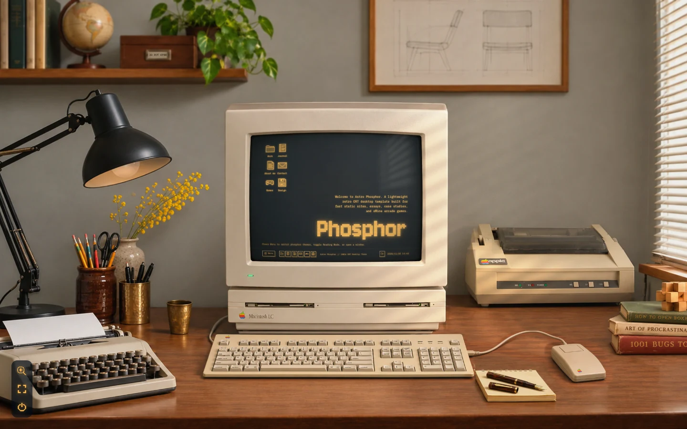
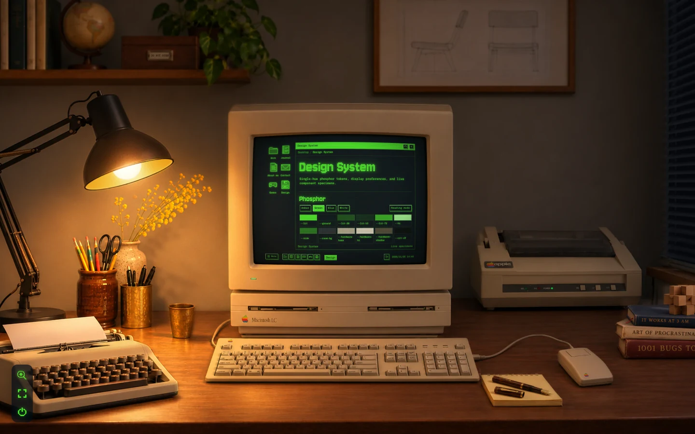
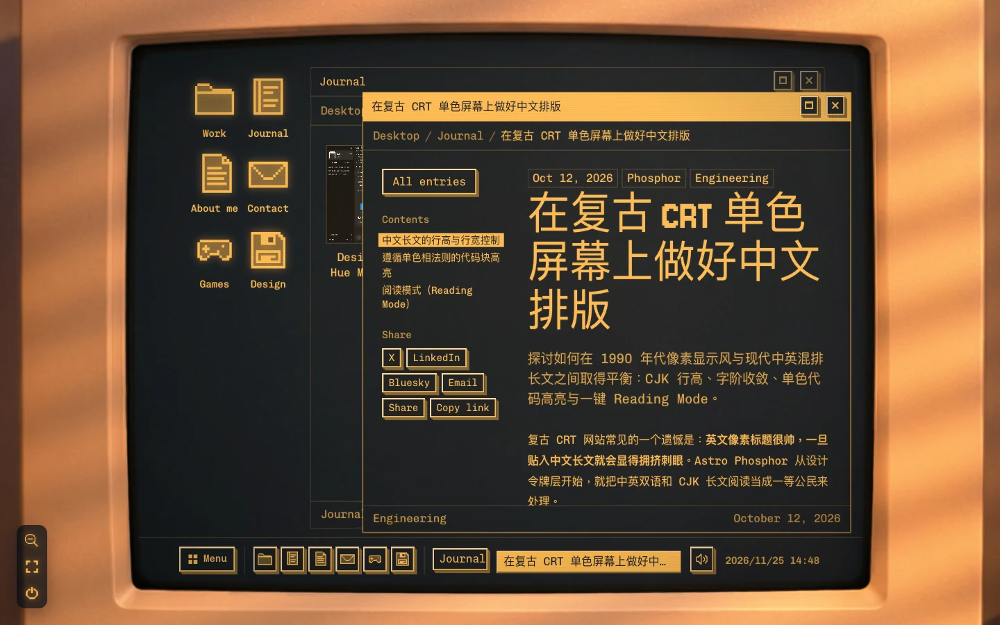
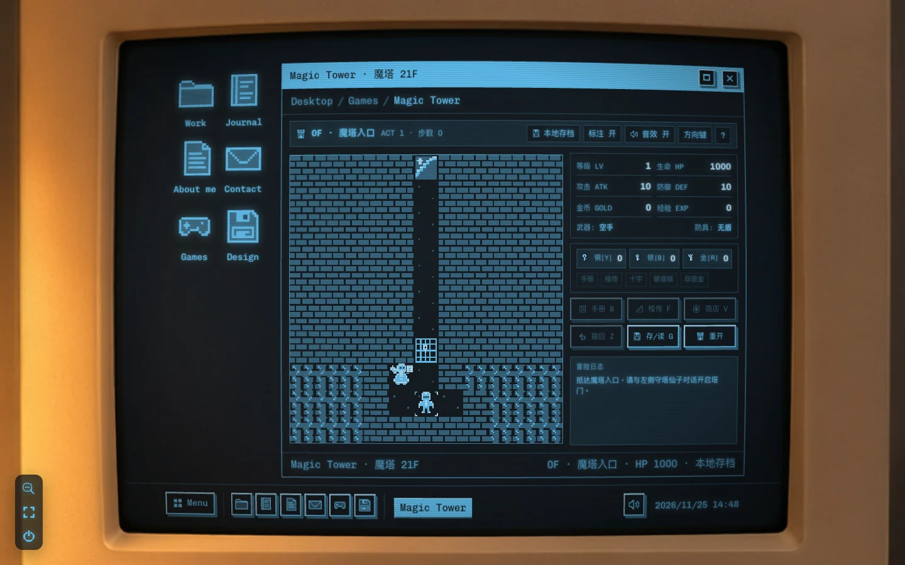

# Astro Phosphor

[English](./README.md) | **简体中文**

一个轻量、**100% 纯静态**的 1990 年代**复古像素 OS 风格**个人站模板，基于 **Astro 5**、**React 19** 与 **Tailwind CSS v4** 构建。

> **纯净模板在线 Demo**：[moonoops.github.io/astro-phosphor](https://moonoops.github.io/astro-phosphor/)（本仓库自动构建的纯静态预览）
>
> **线上实景扩展站**：[xox.pub](https://xox.pub)（基于本模板扩展的个人站点。注意：`xox.pub` 额外接入了 Chat 聊天室、留言板、音视频播放器等需要后端服务的功能，本轻量纯静态模板暂不提供这些后端能力；如有需要，可直接结合仓库内置的 `AGENTS.md` 与 `docs/DESIGN.md` 用 AI 快速搭建扩展。）



<table>
  <tr>
    <td width="33.3%">
      
      <br /><sub><b>夜间台灯光影 · 翠绿荧光 · Design System</b></sub>
    </td>
    <td width="33.3%">
      
      <br /><sub><b>近景缩放 · 阅读模式 · 中英双语 MDX</b></sub>
    </td>
    <td width="33.3%">
      
      <br /><sub><b>冰蓝荧光 · 5 款纯前端离线复古小游戏</b></sub>
    </td>
  </tr>
</table>

---

## 核心特性

- **AI 友好、规范驱动、开箱即二开**：专为 AI 编程助手（Antigravity / Claude Code / Codex / Cursor 等）深度适配。项目用 [`AGENTS.md`](./AGENTS.md) 明确规定了技术栈、Astro/React Islands 边界、路由结构与零后端规范；用 [`docs/DESIGN.md`](./docs/DESIGN.md) 完整约束了复古像素 OS 的单色相设计令牌（4 套荧光主题 + Reading Mode）、响应式像素字阶与 0px 组件风格；并内置可复用 **Agent Skills**（例如 [桌面背景图生成 Skill](./.agents/skills/crt-room-artwork/SKILL.md)，专门指导 AI 生成、重打五时段光影并校准自定义复古桌面背景图），让 AI 扩展新页面、新窗口或自行补齐后端能力都不跑偏。
- **Astro 静态核心 + 持久化 OS 外壳**：100% 纯静态输出（`dist/`），零后端、零数据库。通过 `<ClientRouter />` 与 `transition:persist` 持久化复古桌面外壳，切换窗口路由时绝不重播启动模糊或丢失镜头缩放状态（`Room` / `Close` / `Fullscreen`）。
- **中英双语 MDX 博客与 CJK 排版优化**：内置分类/标签/关键词实时检索、左侧吸顶目录（Scrollspy TOC）、单色 Shiki 代码块与一键 **Reading Mode**；中文长文（`lang: zh-CN`）自动启用 `1.75` 行高与收敛标题字阶。
- **5 款 100% 离线复古小游戏**：扫雷、俄罗斯方块、贪吃蛇、2048、21 层魔塔（`Magic Tower · 魔塔 21F`）——纯 TypeScript + Canvas + Web Audio 合成 8-bit 音效 + `localStorage` 本地纪录与多槽位存档。

---

## 页面清单

| 路由 | 说明 |
| :--- | :--- |
| `/` | 复古像素桌面首页（6 枚对称快捷图标、`TypedText` 欢迎语、大号像素壁纸标题） |
| `/work` 与 `/work/[slug]` | 精选作品集网格 + 案例详情子窗口 + 真彩全屏灯箱（`GalleryLightbox`） |
| `/journal` 与 `/journal/[slug]` | 纯静态 MDX 博客，支持搜索/分类/标签过滤、目录追踪与阅读模式 |
| `/about` | 个人简介、像素头像、规格表、工作流向导（`SetupWizard`）、时间线与 `FAQPanel` |
| `/contact` | 复古邮件客户端表单（配置邮箱后唤起 `mailto:`，未配置自动下载本地 `.txt` 草稿） |
| `/design-system` | 实时交互式设计系统标本页（切换主题/阅读模式，预览全部令牌、字阶、按键、图标与组件） |
| `/games` | 离线街机中心，内置扫雷、俄罗斯方块、贪吃蛇、2048、魔塔 21F |
| `/404` | 经典复古报错小弹窗 |

---

## 快速开始

环境要求：**Node.js `^20.19.0` 或 `>= 22.12.0`**。

```sh
npm install
npm run dev
```

打开 `http://localhost:4321` 即可预览。

### 常用命令

```sh
npm run check         # 运行 Astro 诊断与 TypeScript 严格类型检查
npm run build         # 构建 100% 静态产物至 dist/
npm run preview       # 本地预览 dist/ 构建结果
npm run art:room      # 将自定义五时段桌面原图压缩为响应式 WebP
npm run test:browser  # 运行 Playwright 浏览器自动化测试（需本机安装 Chrome）
```

---

## 个性化定制与 AI 二开

1. **站点名称与社交链接**：修改 [`src/site.ts`](./src/site.ts) 与 [`src/data/page-copy.json`](./src/data/page-copy.json)。
2. **作品集内容**：编辑或替换 [`src/content/projects/`](./src/content/projects/) 中的 `.mdx` 文件，配图放在 `public/media/work/`。
3. **撰写文章**：在 [`src/content/journal/`](./src/content/journal/) 新建 `.mdx` 文件；中文长文在 frontmatter 填写 `lang: zh-CN`，草稿可设 `draft: true`。
4. **邮箱与域名配置**：复制 `.env.example` 为 `.env`：
   - 填写 `PUBLIC_CONTACT_EMAIL` 开启联系页 `mailto:` 唤起（留空则自动切换为本地草稿下载）。
   - 构建前可设置 `SITE_URL`（以及子路径部署时的 `SITE_BASE`）。
5. **用内置 Skill 更换自定义复古桌面背景图**：直接让你的 AI 编程助手读取并执行内置的 [桌面背景图生成 Skill](./.agents/skills/crt-room-artwork/SKILL.md)，按规范生成 16:9 正视角复古主机书桌底图与五时段光影变体，运行 `npm run art:room` 压图并校准 `src/geometry/tube.ts` 中的屏幕视口坐标。
6. **预览五时段光影**：在任意页面 URL 后加上 `?scene=morning` / `noon` / `afternoon` / `dusk` / `night` 即可切换。

---

## 一键静态部署

- **GitHub Pages（已内置自动工作流）**：点击仓库右上角 **Use this template**，在 **Settings → Pages → Source** 选择 **GitHub Actions**，推送到 `main` 即通过 [`.github/workflows/deploy-pages.yml`](./.github/workflows/deploy-pages.yml) 自动构建部署（自动适配子路径 `SITE_BASE`）。
- **Cloudflare Pages / Vercel / Netlify**：关联仓库，构建命令填 `npm run build`，输出目录填 `dist`。

将托管平台的 404 页面指向 `dist/404.html`，即可自动展示复古报错弹窗。

---

## 致谢与开源协议

- **设计灵感**：感谢 **@realmehedi1** 在 Framer 上发布的免费模板（*Nostalgia Computer*）带来的复古像素 OS 风格灵感；本仓库所有代码、像素图标、光影效果与五时段复古书桌背景图均为独立编写/生成。
- **社区致谢**：特别感谢 **[LINUX DO](https://linux.do)** 社区的开源氛围、灵感交流与反馈。
- **离线游戏**：*魔塔 21F* 玩法致谢经典开源项目 `ckcz123/mota-js`，底层引擎与单色像素精灵图均使用 TypeScript 与 Canvas 独立重制。
- **字体**：通过 Fontsource 自托管 *Jersey 10* 与 *Chivo Mono*。

基于 [MIT License](./LICENSE) 开源。
